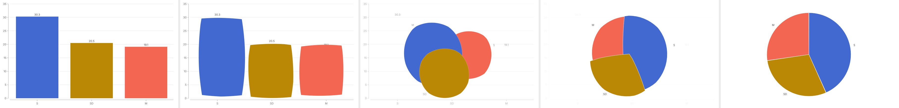
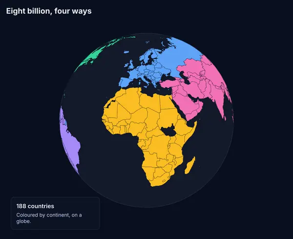
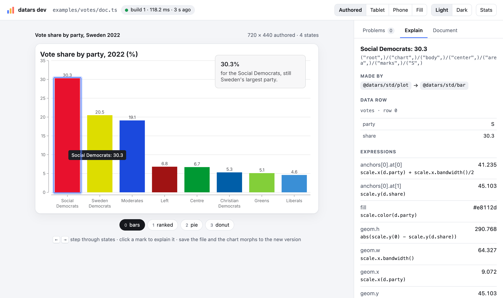

# datars

**One chart engine for every screen.**

No charting framework runs on every screen. D3 draws in a browser. Swift Charts draws on Apple's
platforms. Android has no charts built in. A video or a printed page means redrawing the chart by
hand in After Effects or Illustrator. So a chart that has to be on your site, in your apps, in a
video and in print gets built once per screen, by different people with different tools.

datars is one engine for all of them. You write the chart once, as a small TypeScript document. A
deterministic Rust engine lays it out, shapes its text, animates it and draws it natively: on the
web (WebAssembly), in iOS and Android apps, on the desktop, and into MP4, PNG, SVG and PDF. Every
screen gets the same pixels, the same line breaks and the same motion. You publish the chart as a
small bundle that sites and apps load at runtime, so fixing a number means republishing the chart.
No site deploy, no app release.

[Website](https://rahlenjakob.github.io/datars/) ·
[Why datars](https://rahlenjakob.github.io/datars/why/) ·
[Gallery](https://rahlenjakob.github.io/datars/gallery/) ·
[Docs](https://rahlenjakob.github.io/datars/docs/) ·
[Quick start](#quick-start) ·
[Status](docs/19-status.md)


<sub>One document at the same step on five targets, each at the iPhone 16 Pro's chart box.
[Lay any two over each other and measure the difference →](https://rahlenjakob.github.io/datars/features/platforms/)</sub>

**89** chart recipes · **6** targets from one document · **4,000,000** points in one live chart ·
**1.6 MB** web runtime, cached once, then charts from **14 KB** · **1,281** Rust tests, plus pixel
and motion goldens

## Why teams pick it

- **Same pixels everywhere.** The engine draws every pixel, text included. Every example hashes
  the same on five targets. [Platforms →](https://rahlenjakob.github.io/datars/features/platforms/)
- **Motion by key.** Marks keep their data's key, so bars become slices with no transition code.
  Every transition is tested at 64 sampled frames. [Animation →](https://rahlenjakob.github.io/datars/features/animation/)
- **Data stories and scroll.** Stories can be stepped, scroll-scrubbed or autoplaying, and the same
  story renders as a captioned video. [Stories →](https://rahlenjakob.github.io/datars/docs/stories/) ·
  [Articles →](https://rahlenjakob.github.io/datars/articles/)
- **Maps down to the street.** Fly from the globe to a street corner over a basemap cut from
  OpenStreetMap into one static file. No tile server, no API key. [Maps →](https://rahlenjakob.github.io/datars/features/maps/)
- **Big data.** Four million points open from a 38 KB bundle and stream by range. Camera tours
  run at 59–60 fps in Chrome. [Big data →](https://rahlenjakob.github.io/datars/features/big-data/)
- **Themes and brands.** Colours, fonts and shapes are tokens resolved at draw time, so an app can
  brand a chart someone else published. [Theming →](https://rahlenjakob.github.io/datars/features/theming/) ·
  [Theme studio →](https://rahlenjakob.github.io/datars/themes/)
- **Accessible on every host.** Screen readers get every mark's role, label and value. Text grows
  with the reader's setting, and each WCAG 2.2 A and AA criterion says who answers for it, with a
  named test for every one datars does. TalkBack and
  VoiceOver have been driven for real. [Accessibility statement →](https://rahlenjakob.github.io/datars/docs/accessibility/)
- **Icons and pictures.** Lucide icons, your own SVGs and pictures draw in the theme's inks, up to
  a thousand-icon pictogram, and all of it travels inside the bundle. [Icons →](site/docs/icons.md)
- **Charts are content.** A chart is static files on any host. Republish it and every embed
  updates, apps included. You can sign them, and there's no chart server or third-party CDN.
  [Delivery →](https://rahlenjakob.github.io/datars/features/delivery/)
- **Tools for developers and agents.** A live page morphs each edit in. `explain`, `lint` and
  `labels` find what's wrong and suggest fixes, and the same tools run over MCP. [Developers →](https://rahlenjakob.github.io/datars/features/developers/)
- **89 recipes, nothing sealed.** Bars to sankeys, candlesticks to gauges, maps to controls, all
  in TypeScript you can eject and edit. [Charts →](https://rahlenjakob.github.io/datars/features/charts/) ·
  [Extending →](https://rahlenjakob.github.io/datars/features/extensibility/)
- **React, Vite, Next.js, Jupyter.** Use `<DatarsView chart={sales} />`, import chart files like
  modules, or `import datars as dr`. [React →](https://rahlenjakob.github.io/datars/docs/react/) ·
  [Python →](https://rahlenjakob.github.io/datars/docs/python/)

## A chart is a small program

```ts
import { doc, data, e, group, signal, story, step } from "@datars/sdk";
import { plot, bar, pie } from "@datars/std";

export default doc({
  title: "Vote share",
  size: [720, 440],
  data: {
    votes: data.values({ party: ["S", "SD", "M"], share: [30.3, 20.5, 19.1] }, { key: "party" }),
  },
  signals: { shape: signal.str("bars") },
  scene: group({
    key: "root",
    layout: { type: "stack", padding: [16, 20, 12, 12] },
    children: [
      plot({ data: "votes", x: "party", y: "share", color: "party",
        children: [bar({ labels: true })] }, { key: "chart", when: e('shape == "bars"') }),
      pie({ data: "votes", value: "share", category: "party" },
        { key: "chart", when: e('shape == "pie"') }),
    ],
  }),
  program: story({
    steps: [step("bars", { set: { shape: "bars" } }), step("pie", { set: { shape: "pie" } })],
  }),
});
```

Each party has a key, so stepping from `bars` to `pie` morphs each bar into its own slice. The
signal `shape` says which chart shows, and the two steps set it. The engine plans the motion.
`datars film doc.ts --from 0 --to 1` draws that transition:



The same idea scales up. In this example, 188 countries are keyed by ISO code. One custom recipe of
71 lines turns each country on a globe into a planet the size of its population, then a golden
spiral, then blocks. This is the engine's own film of it, from `datars video`:



## Quick start

datars isn't on npm or crates.io yet, so you build it from this repository. You need
[Rust](https://rustup.rs) (stable), [Node](https://nodejs.org) 20+ and [pnpm](https://pnpm.io).
The web runtime is WebAssembly and needs a one-time setup, listed at the top of
[`scripts/build-wasm.sh`](scripts/build-wasm.sh): the `wasm32-unknown-unknown` target,
`wasm-bindgen-cli` 0.2.128, and LLVM with wasi-libc (`brew install llvm wasi-libc` on macOS).
The first build takes a few minutes.

```sh
git clone https://github.com/rahlenjakob/datars && cd datars
cargo install --path crates/datars-cli   # the datars command
pnpm install
bash scripts/build-wasm.sh               # the web runtime, into packages/web/dist
pnpm build                               # the TypeScript packages
```

Then, in the clone (an installed `datars` finds the packages and the web runtime from there):

```sh
datars new sales --template story        # sales/doc.ts: bars that morph into a pie
datars dev sales/doc.ts                  # live page on :8788; save and it morphs
datars lint sales/doc.ts                 # keys, encodings, legibility, contrast
datars render sales/doc.ts --state pie --out pie.png
datars publish sales/doc.ts --alias sales --to out/site
datars serve out/site                    # on :8787, every chart on one page
```

`out/site` is plain files: `c/sales`, the manifest that embeds follow, and immutable chunks. Put it
on any static host with the web runtime (`packages/web/dist`) beside it as `runtime/`, and embed:

```html
<script type="module" src="/runtime/datars.js"></script>
<datars-view src="/c/sales"></datars-view>
```

The same chart plays in apps: `DatarsChart(source: .url(…))` in SwiftUI,
`DatarsView(context).load(…)` on Android, `<DatarsView>` from `@datars/react`. Other templates are
`chart`, `explorable` and `map`. To keep your charts in a project of their own, follow the
[getting-started guide](https://rahlenjakob.github.io/datars/docs/getting-started/).

## The dev loop

`datars dev` serves the chart live, with its states, phone and tablet sizes (charts lay themselves
out again rather than scale), light and dark, problems with fixes, a profiler, and Explain for any
mark you click.



Everything the page shows is also a command. That means it works in a terminal, in CI and for
coding agents:

```sh
datars check   doc.ts                  # diagnostics, with the nearest valid name
datars lint    doc.ts                  # identity, encoding, legibility, accessibility, theme
datars labels  doc.ts                  # unreadable labels, phone to desktop, 1–2× text
datars explain doc.ts --key '("S",)'   # why an element looks the way it does
datars film    doc.ts --from 0 --to 1  # a filmstrip and motion trails of a transition
datars profile doc.ts                  # every state and transition, timed at 60 fps
datars video   doc.ts --out story.mp4  # MP4 with WebVTT captions (needs ffmpeg)
datars test                            # goldens: every state, 64 samples of every transition
```

The [tools guide](https://rahlenjakob.github.io/datars/docs/tools/) and the
[CLI reference](https://rahlenjakob.github.io/datars/docs/cli/) cover the rest: `data profile`,
`describe`, `diff`, `semantics`, `eject`, `keygen` and more.

## Platforms

| Target | Draws with | You embed | Verified |
|---|---|---|---|
| Web | WebAssembly: WebGPU, WebGL2 fallback, CPU fallback | `<datars-view>`, `@datars/react`, `@datars/vite`, `@datars/next` | Hash-identical goldens in wasm; publish → serve → republish tests; accessibility trees in Chromium, WebKit and Gecko; VoiceOver in Safari and Chrome |
| iOS | Metal | DatarsKit: `DatarsChart` (SwiftUI) | iPhone 16 Pro simulator: goldens, a chart published after the app was built, frames on Metal |
| macOS | Metal | DatarsKit; the `datars-view` desktop viewer | `swift test`, goldens, VoiceOver |
| Android | Vulkan, else OpenGL ES | AAR: `DatarsView` (Kotlin) | Android 15 emulator (arm64): goldens, the sample app on GLES, TalkBack driven |
| Video | The CPU reference, frame-exact | `datars video`: H.264 MP4 + WebVTT captions | The same frames the goldens test |
| Print and images | The CPU reference; vector SVG and PDF with text as text | `datars render`; `datars serve` answers `/render/<alias>.png\|svg\|pdf` | Goldens; perceptual GPU-vs-CPU check (`datars gpu`, ΔE) |
| Notebooks | The web runtime | `packages/python` (`import datars as dr`), anywidget | pytest, headless Chrome, JupyterLab 4 (first version) |

The evidence for each line, and the commands that re-run it, are in
[docs/19-status.md](docs/19-status.md). Not done yet: no phone app has run on a physical device,
so Vulkan on Android and the GPU path on real phones are untested. NVDA and JAWS have never read a
datars chart (an NVDA run is [prepared](ci/windows-nvda/README.md)). iOS VoiceOver is checked with
Xcode's accessibility audit, not driven. The packages aren't on npm, crates.io or PyPI, and the
bundle format isn't frozen at 1.0.

## For coding agents

Charts are typed documents, and every tool is deterministic and prints text or writes an image to
a known path, with no GPU or browser needed. An agent can write a chart, look at it and fix it.
`datars-mcp` serves 13 tools over the Model Context Protocol: check, render, film, inspect, lint,
semantics, explain, diff, data profile, describe recipes, tests, bundle and replay
(`cargo install --path crates/datars-mcp`, then `claude mcp add datars -- datars-mcp`). Agents
without MCP get the same from the CLI with `--json`. [`llms.txt`](llms.txt) is the compact index,
and the document format is a JSON Schema ([`docs/reference/ir.schema.json`](docs/reference/ir.schema.json)).
See [Coding agents and MCP](https://rahlenjakob.github.io/datars/docs/agents/).

## Build and test

[CONTRIBUTING.md](CONTRIBUTING.md) has the full setup, including the optional Apple and Android
toolchains (`scripts/build-apple.sh`, `scripts/build-android.sh`).

```sh
cargo build --release -p datars-cli   # target/release/datars
cargo test --workspace --release      # 1,281 Rust tests
target/release/datars test            # goldens over examples/: every state, every transition
target/release/datars gpu             # this machine's GPU against the CPU reference
node scripts/build-site.mjs           # the website, every chart live, into out/pages
```

| Path | What |
|---|---|
| `crates/datars-{math,color,theme,scene,text,data,expr,algo,layout,graph,motion,geo,ir}` | the engine's layers: deterministic, sans-IO |
| `crates/datars-engine` | documents → tables → scenes → transitions → frames: the host contract |
| `crates/datars-render-{cpu,svg,pdf,wgpu}` | the bit-exact CPU reference, SVG, PDF, and the GPU (WebGPU, WebGL2, Metal, Vulkan, GLES, DX12) |
| `crates/datars-sandbox` | QuickJS with deterministic `Math`, for recipes |
| `crates/datars-bundle`, `datars-build` | the bundle format and loader; the publish compiler |
| `crates/datars-runtime`, `datars-host-{web,native}`, `datars-ffi` | the installed runtime and its hosts; the C ABI for Swift and Kotlin |
| `crates/datars-{cli,devtools,test,headless,mcp}` | the `datars` command, lint and explain, the golden tests, headless rendering, the MCP server |
| `crates/datars-geo-build` | OpenStreetMap and Natural Earth → vector tiles and atlases |
| `packages/{sdk,std,web,react,vite,next,compile,python}` | `@datars/sdk`, `@datars/std`, `<datars-view>`, the React, Vite and Next.js integrations, notebooks |
| `apple/DatarsKit`, `android/` | the Swift package (iOS, macOS) and the Android library |
| `examples/` | 23 example documents, each also a golden test |
| `site/` | the website: docs, gallery, articles, every chart live |
| `docs/` | [how it works and why](docs/README.md): the design documents |

## Community and licence

Questions and ideas go to [GitHub Discussions](https://github.com/rahlenjakob/datars/discussions).
Bugs go to [issues](https://github.com/rahlenjakob/datars/issues): a small document that reproduces
the bug helps most. Pull requests aren't accepted ([CONTRIBUTING.md](CONTRIBUTING.md)). For
security reports, see [SECURITY.md](SECURITY.md). Everyone taking part follows the
[code of conduct](CODE_OF_CONDUCT.md).

datars is source available: © 2026 Jakob Råhlén, all rights reserved
([LICENSE](LICENSE)). The source is published to be read. Using, copying or distributing it needs
written permission. Third-party material (fonts, map data, icons, ported algorithms) is listed in
[THIRD_PARTY_NOTICES.md](THIRD_PARTY_NOTICES.md).
